# Pico2Arcade

**Classic arcade games on a Raspberry Pi Pico 2 — straight from your own MAME
ROM files.** No PC tools, no ROM conversion, no rebuild per game: flash one
file, copy the zips onto the USB drive it shows up as, and play.

<table>
<tr>
<td align="center" width="20%">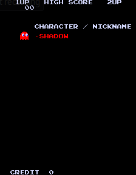<br><sub>Pac-Man</sub></td>
<td align="center" width="20%">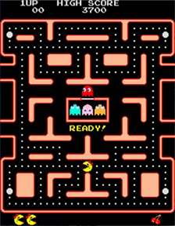<br><sub>Ms. Pac-Man</sub></td>
<td align="center" width="20%">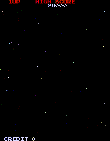<br><sub>Galaga</sub></td>
<td align="center" width="20%">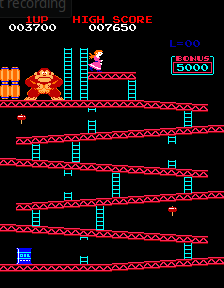<br><sub>Donkey Kong</sub></td>
<td align="center" width="20%">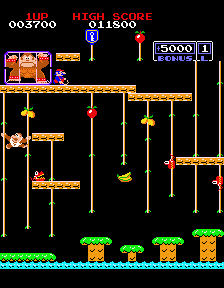<br><sub>Donkey Kong Jr.</sub></td>
</tr>
<tr>
<td align="center" width="20%">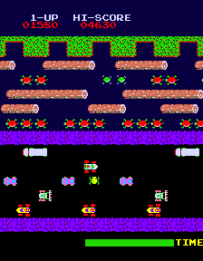<br><sub>Frogger</sub></td>
<td align="center" width="20%">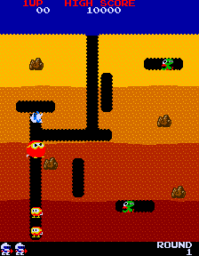<br><sub>Dig Dug</sub></td>
<td align="center" width="20%">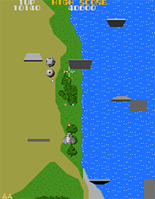<br><sub>Xevious</sub></td>
<td align="center" width="20%">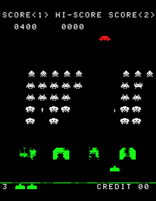<br><sub>Space Invaders</sub></td>
<td align="center" width="20%">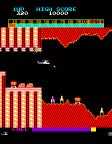<br><sub>Super Cobra</sub></td>
</tr>
<tr>
<td align="center" width="20%">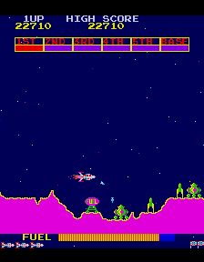<br><sub>Scramble</sub></td>
<td align="center" width="20%">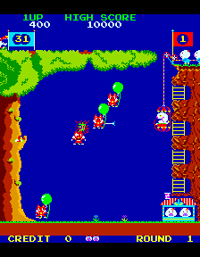<br><sub>Pooyan</sub></td>
<td align="center" width="20%">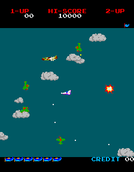<br><sub>Time Pilot</sub></td>
<td width="20%"></td>
<td width="20%"></td>
</tr>
</table>

<sub>Screenshots from [GalaginoPlus](https://github.com/VirtualClaudioBoy/GalaginoPlus) (GPLv3).</sub>

Thirteen games, all at full 60 fps on the RP2350: **Pac-Man**, **Ms. Pac-Man**
(with the Midway F2 aux board emulated), **Galaga**, **Donkey Kong**,
**Donkey Kong Jr.** (US or Japan set), **Frogger**, **Dig Dug**, **Xevious**,
**Space Invaders**, **Super Cobra**, **Scramble**, **Pooyan** and **Time Pilot**.
Each game keeps its high-score table across power cycles.

Pico2Arcade is a port of Till Harbaum's [Galagino](https://github.com/harbaum/galagino)
ESP32 arcade emulator, with the later games ported from
[GalaginoPlus](https://github.com/VirtualClaudioBoy/GalaginoPlus).

## See it in action

[](https://youtu.be/qfoUFOv9sbY)

▶ **[Watch the demo on YouTube](https://youtu.be/qfoUFOv9sbY)** — a Pico 2 wired up to a display, buttons and a speaker, then playing.

## Where it runs

Build your own with a **Raspberry Pi Pico 2**, or play it on iCode hardware
that already has the screen, controls and speaker built in — there the arcade
is one menu entry away and runs alongside the device's normal job.

<table>
<tr>
<td width="380" align="center" valign="top">
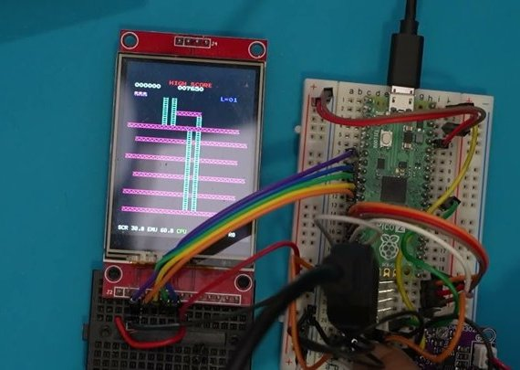<br>
<b>Raspberry Pi Pico 2</b> — do it yourself<br>
<a href="#standalone-pico-2--quick-start">➜ Build guide below</a>
</td>
<td valign="top">

- Any **Raspberry Pi Pico 2**, an **ST7789** or **ILI9341** 240×320 SPI display, a joystick or switches, and a small amplifier and speaker
- Every pin is set in a text file (`ARCADE.INI`) — wire it the way your build needs
- ROMs go on a **1 MB USB drive** in the Pico's own flash: copy the zips, eject, play
- [Watch the build in action](https://youtu.be/qfoUFOv9sbY)

</td>
</tr>
<tr>
<td width="380" align="center" valign="top">
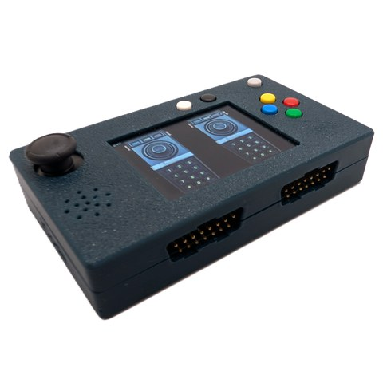<br>
<b>iCode Duo 5200 Ultimate</b> — Atari 5200 USB adapter<br>
<a href="https://www.icode.com/product/icode-duo-5200-ultimate-usb-adapter-for-atari-5200-retro-gaming-controllers/">➜ Get it at icode.com</a>
</td>
<td valign="top">

- **Arcade Games** in the Mini-Games menu (firmware 1.1 or later), on the built-in color screen with sound
- Play with your **original Atari 5200 controller** — the analog stick steers, both fire buttons work — or the on-device stick and buttons
- **512 KB ROM drive** over USB: room for every game
- Also its everyday job: a two-port USB adapter for Atari 5200 controllers

</td>
</tr>
<tr>
<td width="380" align="center" valign="top">
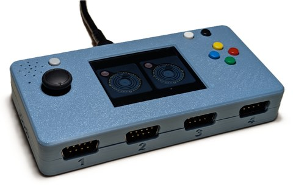<br>
<b>iCode Quad Ultimate CX / CX-W</b> — 4-port Atari USB adapter<br>
<i>➜ Coming soon at <a href="https://www.icode.com">icode.com</a></i>
</td>
<td valign="top">

- **Arcade Games** in the Mini-Games menu, on the built-in 2.4" color screen with sound
- Play with an **Atari joystick** on port 1 or the on-device thumbstick and buttons
- **256 KB ROM drive** over USB
- Also its everyday job: a four-player USB adapter for Atari 2600/7800 controllers — the CX-W adds Bluetooth

</td>
</tr>
<tr>
<td width="380" align="center" valign="top">
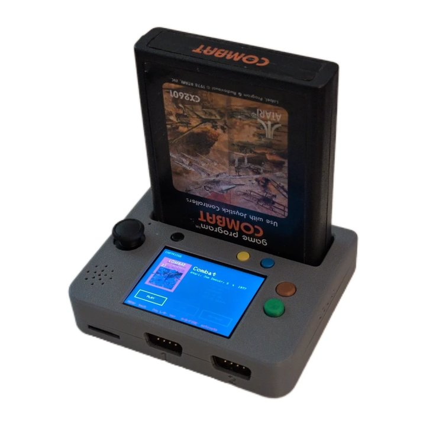<br>
<b>iCode 2600CartReaderPlayer</b> — plays real Atari 2600 cartridges<br>
<i>➜ Coming soon at <a href="https://www.icode.com">icode.com</a></i>
</td>
<td valign="top">

- An **ARCADE** tile right next to the cartridge player
- Play with an Atari joystick or the on-device controls
- ROM zips go in `/roms/` on its **SD card**

</td>
</tr>
</table>

We do **not** distribute ROMs. Use ROM sets you are entitled to.

---

## Standalone Pico 2 — quick start

### 1. Parts

- Raspberry Pi **Pico 2** (RP2350A, 4 MB flash). The original Pico (RP2040)
  does not have enough RAM.
- **240×320 SPI display** with an **ST7789** or an **ILI9341** controller
  (the common 2.0"–2.8" modules; the controller is printed on the module or
  in the listing). Each needs its own firmware: `pico2_std` for the ST7789,
  `pico2_std_ili9341` for the ILI9341. With the wrong one the screen stays
  white.
- A joystick or four direction switches, plus buttons for FIRE, START, COIN
  and MENU. All are simple switches to GND; the Pico's internal pull-ups are
  used.
- A speaker with a small amplifier (for example a PAM8302A class-D board).
  The Pico outputs PWM audio; wire the audio pin straight to the amplifier
  input (A+, with A− to GND) — the amplifier module filters the PWM itself.

### 2. Wiring (defaults)

The display pins are fixed. Everything else is the default and can be changed
in `ARCADE.INI` (step 4).

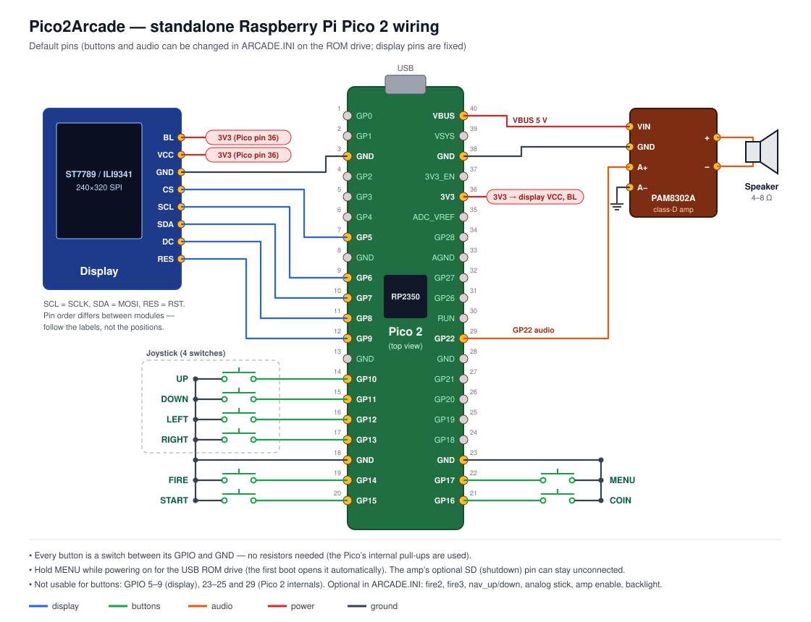

▶ **See this wiring in action:** [video demo on YouTube](https://youtu.be/qfoUFOv9sbY).

| Function | GPIO | | Function | GPIO |
|---|---|---|---|---|
| Display SCLK | 6 | | Joystick UP | 10 |
| Display MOSI (SDA) | 7 | | Joystick DOWN | 11 |
| Display CS | 5 | | Joystick LEFT | 12 |
| Display DC | 8 | | Joystick RIGHT | 13 |
| Display RST | 9 | | FIRE | 14 |
| Display VCC / GND | 3V3 / GND | | START | 15 |
| Display backlight (BL) | 3V3 (or a GPIO, see `backlight`) | | COIN | 16 |
| Audio (PWM out) | 22 | | MENU | 17 |

GPIO 23, 24, 25 and 29 are used on the Pico 2 board itself and can't be
mapped.

### 3. Flash the firmware

Hold **BOOTSEL** while plugging the Pico 2 into USB, then copy the UF2 for
your display (ST7789 or ILI9341) onto the `RP2350` drive that appears. To build it yourself, see
[Build](#build).

### 4. Copy the ROMs and set the pins

On the first boot the Pico formats its ROM drive and shows up on your
computer as a USB drive called **ARCADE ROMS**. The screen shows
"ROM Drive (USB)".

1. Copy the ROM zips onto the drive, either in the root or in a `ROMS` folder
   (see [ROM sets](#rom-sets)).
2. If your wiring differs from the defaults, edit **`ARCADE.INI`** on the
   drive.
3. Eject the drive, then press **MENU** or **START**. The Pico restarts into
   the game list.

To get back to the ROM drive later, pick **ROM Drive (USB)** in the game list,
or hold **MENU** while powering on.

### ARCADE.INI

A commented `ARCADE.INI` with the defaults is written when the drive is
formatted. One `key = value` per line; `-1` means not connected; `;` or `#`
starts a comment.

| Key | Default | Meaning |
|---|---|---|
| `up` `down` `left` `right` | 10 11 12 13 | joystick directions |
| `fire` | 14 | fire button |
| `fire2` `fire3` `fire4` | -1 | extra fire buttons (optional) |
| `fire_b` `fire_b2` `fire_b3` | -1 | second fire buttons for two-button games, e.g. Super Cobra's bomb (fire otherwise); with no `fire_b`, `fire` does both (optional) |
| `start` | 15 | START |
| `coin` | 16 | COIN (insert credit) |
| `menu` | 17 | MENU: tap = back / exit the list, hold in a game = game list, hold at power-on = ROM drive |
| `nav_up` `nav_down` | -1 | extra menu-only UP / DOWN buttons (optional) |
| `joy_x` `joy_y` | -1 | analog stick on ADC pins 26–28 (optional) |
| `joy_click` | -1 | analog stick click = fire (optional) |
| `audio` | 22 | PWM audio output |
| `amp` | -1 | amplifier enable, driven HIGH while a game plays (optional) |
| `backlight` | -1 | display backlight, driven HIGH (optional) |

Lines with an unknown key or an invalid pin keep the default, and the game
list shows a red warning naming the first bad line.

---

## Playing

**Game list**

- **UP / DOWN** select a row. **FIRE** or **START** picks it.
- Game names are yellow. A game is listed only if its zip is on the drive.
  A zip that isn't the supported ROM set is listed in **red**; picking it
  explains which file is missing or wrong.
- **Display: Landscape / Portrait**: portrait is the arcade's own full-size
  picture; landscape scales it to fit the panel sideways.
- **Show FPS**: frame-rate overlay.
- **ROM Drive (USB)**: restarts as the USB ROM drive (flash-drive boards).
- **Volume**: LEFT / RIGHT change it in 10 % steps; FIRE steps up and wraps
  to mute. There is no in-game volume control.
- **Exit**: a MENU tap does the same. Standalone, this restarts the list.
  Under the Quad or PicoCartReader it returns to that firmware.

**In a game**

- Joystick + FIRE; START and COIN as on the cabinet.
- Two-button games (Super Cobra and Scramble: laser / bomb; Xevious:
  zapper / bomb) use **A** for the first and **B** for the second. A
  one-button joystick (PicoCartReader external stick, Quad DB9) fires both.
  On the Quad / Duo 5200 the device buttons follow GameAdapterRGBPico:
  Red (button 0) and Blue = A, Green (button 1) and Yellow = B; the Duo
  5200 controller's Fire A / Fire B are A / B. Standalone: `fire_b` in
  `ARCADE.INI`.
- **Hold MENU for one second** (or hold START + COIN) to go back to the game
  list.

**High scores are kept** across power cycles, like MAME's hiscore plugin:
once a game has set up its high-score table after starting, the saved one is
put back. New scores are saved when you **leave the game** (hold MENU, or
START + COIN), never during play. Switching the power off without leaving
the game loses that session's new scores.

Settings (display orientation, FPS overlay, volume) are saved in flash on
the standalone board. On the Quad the Quad keeps them; on the PicoCartReader
they're on the SD card (volume: kept by the CartReader).

---

## ROM sets

One MAME set per game: the **parent set, non-merged** (the zip holds every
file the game needs, including files shared with a parent). Older or newer
MAME versions that renamed a ROM file are fine: a file missing under its
name is found by its CRC32. **Merged** sets (with every clone inside) are
not supported: the whole zip is read into RAM, and they're too big.

**Quad / Duo 5200: the ROM drive holds about 251 KB.** All the zips together
are larger than that (all 14 zips, DK Jr. Japan included, are ~300 KB), so copy the games you
want until the drive is full; the game list shows whichever zips are there.
The standalone Pico 2 (1 MB drive) and the PicoCartReader (SD card) hold
them all.

| Game | Zip | Files the loader reads |
|---|---|---|
| Pac-Man | `puckman.zip` | `pm1_prg1.6e` … `pm1_prg8.6p`, `pm1_chg1.5e` … `pm1_chg4.5j`, `pm1-1.7f`, `pm1-2.3m`, `pm1-3.1m`, `pm1-4.4a` |
| Ms. Pac-Man | `mspacman.zip` | `pacman.6e` `pacman.6f` `pacman.6h` `pacman.6j`, `u5` `u6` `u7`, `5e` `5f`, `82s123.7f`, `82s126.1m`, `82s126.3m`, `82s126.4a` |
| Galaga | `galaga.zip` (rev B) | `gg1_1b.3p` `gg1_2b.3m` `gg1_3.2m` `gg1_4b.2l` `gg1_5b.3f` `gg1_7b.2c` `gg1_9.4l` `gg1_10.4f` `gg1_11.4d`, `prom-1.1d` `prom-3.1c` `prom-4.2n` `prom-5.5n` |
| Frogger | `frogger.zip` | `frogger.26` `frogger.27` `frsm3.7`, `frogger.606` … `frogger.610`, `pr-91.6l` |
| Donkey Kong | `dkong.zip` (US set 1) | `c_5at_g.bin` `c_5bt_g.bin` `c_5ct_g.bin` `c_5et_g.bin`, `s_3i_b.bin` `s_3j_b.bin`, `v_5h_b.bin` `v_3pt.bin`, `l_4m_b.bin` `l_4n_b.bin` `l_4r_b.bin` `l_4s_b.bin`, `c-2j.bpr` `c-2k.bpr` `v-5e.bpr` |
| Dig Dug | `digdug.zip` | `dd1a.1` … `dd1a.6`, `dd1.7`, `dd1.9`, `dd1.10b`, `dd1.11` … `dd1.15`, `136007.109` … `136007.113` |
| Donkey Kong Jr. | `dkongjr.zip` (US) | `djr1-c_5b_f-2.5b` `djr1-c_5c_f-2.5c` `djr1-c_5e_f-2.5e`, `djr1-c_3h.3h`, `djr1-v.3n` `djr1-v.3p`, `djr1-v_7c.7c` … `djr1-v_7f.7f`, `djr1-c-2e.2e` `djr1-c-2f.2f` `djr1-v-2n.2n` |
| Donkey Kong Jr. (Japan) | `dkongjrj.zip` | `c_5ba.bin` `c_5ca.bin` `c_5ea.bin`, `c_3h.bin`, `v_3na.bin` `v_3pa.bin`, `v_7c.bin` … `v_7f.bin`, `c-2e.bpr` `c-2f.bpr` `v-2n.bpr` |
| Xevious | `xevious.zip` | `xvi_1.3p` … `xvi_7.2c`, `xvi_9.2a` … `xvi_18.4r`, `xvi-2.7n`, `xvi-4.3l` … `xvi-10.6e` (the 50xx/51xx/54xx MCU ROMs aren't needed) |
| Space Invaders | `invaders.zip` | `invaders.h` `invaders.g` `invaders.f` `invaders.e` |
| Super Cobra | `scobra.zip` | `epr1265.2c` `2e` `epr1267.2f` `2h` `epr1269.2j` `2l`, `5c` `5d` `5e`, `epr1273.5f` `epr1274.5h`, `82s123.6e` |
| Scramble | `scramble.zip` | `s1.2d` … `s8.2p`, `ot1.5c` `ot2.5d` `ot3.5e`, `c1.5h` `c2.5f`, `c01s.6e` |
| Pooyan | `pooyan.zip` | `1.4a` `2.5a` `3.6a` `4.7a`, `xx.7a` `xx.8a`, `8.10g` `7.9g`, `6.9a` `5.8a`, `pooyan.pr1` `pr2` `pr3` |
| Time Pilot | `timeplt.zip` | `tm1` … `tm7`, `timeplt.b4` `timeplt.b5` `timeplt.e9` `timeplt.e12` |

When the game list opens, each zip is checked: every file above must be
present with the expected CRC32 (table in
[`src/pico_romcheck.cpp`](src/pico_romcheck.cpp)). The check reads the CRCs
stored in the zip, so it catches missing files and wrong revisions or clone
sets without unpacking anything.

The firmware reads the zip directly, decompresses the files (STORED +
DEFLATE) and converts them in RAM to the format Galagino expects. This is a
C port of the five Python converters that ship with upstream (`romconv`,
`cmapconv`, `tileconv`, `spriteconv`, `audioconv`).

---

## Build

Requires [PlatformIO](https://platformio.org/) (the
`maxgerhardt/platform-raspberrypi` platform with the earlephilhower Arduino
core; `platformio.ini` pulls both in).

```bash
pio run -e pico2_std                 # standalone Pico 2 -> .pio/build/pico2_std/firmware.uf2
pio run -e pico2_std -t upload       # flash it (picotool)
pio run -e pico2_std_ili9341 -t upload   # the same with an ILI9341 display
```

| Env | Board | Notes |
|---|---|---|
| `pico2_std` | Raspberry Pi Pico 2 | standalone; TinyUSB for the ROM drive |
| `pico2_std_ili9341` | Raspberry Pi Pico 2 | as `pico2_std`, ILI9341 display (SPI 50 MHz) |
| `quad` | Quad Ultimate CX | chain-booted by the Quad firmware from its arcade slot (0x360000, ≤ 380 KB); `-t upload` writes only that slot |
| `duo5200` | Duo 5200 Ultimate | chain-booted by the Duo 5200 firmware (1.1+) from its arcade slot (0x300000, ≤ 380 KB; 512 KB ROM drive); `-t upload` writes only that slot |
| `pico2_arcade` | PicoCartReader (Olimex Pico2XL) | chain-booted from the CartReader's arcade window; `-t upload` writes only that window |
| `pico2` | PicoCartReader | flashes at offset 0, **replacing** the CartReader firmware |
| `bench` | PicoCartReader | Z80 benchmark (attract mode, logs to SD) |

Which games are compiled in is set at the top of [`src/config.h`](src/config.h)
(`ENABLE_PACMAN`, `ENABLE_GALAGA`, …). Comment a line to drop that game.

The ST7789 init sequence is replaced by a custom one
(`tft_espi_override/ST7789_Init.h.custom`); `tft_overlay.py` installs it
into each env's TFT_eSPI copy automatically before every build.

### Flash layout (standalone Pico 2, 4 MB)

| Offset | Size | Contents |
|---|---|---|
| 0x000000 | ~330 KB | firmware |
| 0x200000 | 1 MB | FAT12 ROM drive "ARCADE ROMS" |
| 0x300000 | 4 KB | settings (orientation, FPS overlay, volume) |
| 0x301000 | 4 KB | high scores |

Flashing a new firmware UF2 doesn't touch the ROM drive or the settings.

---

## How the port works

Upstream Galagino was designed to run pre-converted game data compiled into
flash on an ESP32. This port turns it into a **runtime ROM loader**, so users
don't need Python or any host-side tooling.

### Architecture at a glance

```
┌───────────┐   ┌──────────────────┐   ┌──────────────────────┐
│ core 0    │   │ core 1           │   │  hardware            │
│           │   │                  │   │                      │
│ setup()   │   │ emulation_task() │   │ ST7789 (SPI0)        │
│ pico_menu │   │  ├─ prepare_     │   │ ROM zips: flash      │
│  pick&    │──▶│  │  emulation()  │──▶│   drive or SD card   │
│  load()   │   │  └─ while(1)     │   │ buttons (GPIO /      │
│           │   │      emulate_    │   │   PCA9539)           │
│ render    │◀──│      frame()     │◀──│ PWM audio            │
│  loop     │   │                  │   │                      │
└───────────┘   └──────────────────┘   └──────────────────────┘
```

Core 0 handles the menu, the ROM load, and the render/scan-out to the TFT
(the "video task" in upstream lingo). Core 1 runs the Z80/i8048 emulator in a
tight `emulate_frame()` loop, gated on a vblank counter that core 0
increments once per screen refresh.

A `g_menu_done` flag holds core 1 in `setup1()` until the user has picked a
game and the runtime ROM pointers are populated, so Galagino's own
attract-mode menu never runs.

### Boards, pins and ROM storage

- [`src/pico_board.cpp`](src/pico_board.cpp): runtime pin table. The Quad has
  a built-in profile; the standalone board reads `ARCADE.INI`. Input
  ([`src/pico_input.cpp`](src/pico_input.cpp)) and audio
  ([`src/pico_audio.cpp`](src/pico_audio.cpp)) are set up from it. The
  PicoCartReader keeps its fixed PCA9539 wiring.
- [`src/pico_romfs.cpp`](src/pico_romfs.cpp): where the zips come from. On
  the PicoCartReader it's the SD card. On the flash boards it's a small
  read-only FAT12/16 reader over XIP: the drive is plain memory, so a zip is
  found in the root directory (or a `ROMS` folder) and copied cluster by
  cluster.
- [`src/pico_drive.cpp`](src/pico_drive.cpp): USB ROM drive mode (TinyUSB
  mass storage). Writes go through a 4 KB flash-sector cache, with core 1
  idled around each erase/program. The drive is formatted FAT12 on first use.
- [`src/pico_handoff.cpp`](src/pico_handoff.cpp): watchdog scratch registers
  carry volume, display orientation and "start in ROM drive mode" across
  reboots and to/from a host firmware (Quad / PicoCartReader), which
  chain-boots this image with the boot ROM's `rom_chain_image()`.

### Hitting 60 Hz on the RP2350

Real arcade hardware runs at 60 Hz. Getting Galagino there on the RP2350
took a chain of specific choices; if any one drops, the emulator halves its
speed and everything drags.

**System / peripheral clocks.** The `board_build.f_cpu = 200000000L` in
[`platformio.ini`](platformio.ini) runs the CPU at 200 MHz (vs. 150 MHz
default). SPI runs at 100 MHz (`-DSPI_FREQUENCY=100000000`). Galaga is the
tightest of the six games: its three-Z80 frame takes close to 13 ms of the
16.6 ms budget, so the CPU headroom matters. Ms. Pac-Man's F2 fetch adds a
small per-opcode branch on top of that.

**One `pushImage` per frame.** The render task in
[`src/video.cpp`](src/video.cpp) builds the whole 224×288 game framebuffer in
RAM and hands it to TFT_eSPI as a single `pushImage` per screen refresh — no
per-row DMA restarts, no per-tile flushes. At 100 MHz SPI, that transfer
costs about `224*288*2*8 / 100e6 = 10.3 ms`, leaving ~6 ms for the render
pass. Splitting the transfer smaller was tried and consistently missed the
vblank budget.

**Half-rate display, double-rate emulation.** Config leaves `TFT_SPICLK`
undefined, which selects Galagino's `VIDEO_HALF_RATE` mode: the render loop
calls `xTaskNotifyGive` **twice per screen refresh** and the display runs at
30 fps while the emulator gets **two vblank pulses per refresh** and ticks at
60 Hz. Trying a 1:1 sync pinned the emulator to display rate (~30 fps) and
everything felt sluggish; the double-pulse fix keeps game clocks honest.

**vblank counter must decrement, not clear-all.** Real FreeRTOS's
`ulTaskNotifyTake(pdTRUE, …)` clears the count and returns the old value.
That semantic is wrong for `VIDEO_HALF_RATE`: if two pulses arrive between
`emulate_frame()` calls and we clear, the second pulse is lost and the
emulator drops to half speed. Our stub in
[`src/pico_freertos_stubs.c`](src/pico_freertos_stubs.c) always decrements
by one instead — every pulse is accounted for regardless of the caller's
`clearOnExit` argument.

**Core split.** Core 0 owns the video task (100 MHz SPI + TFT_eSPI is already
close to full-duty on the peripheral side). Core 1 runs `emulation_task()` —
60 Hz Z80/i8048 stepping plus the audio-render loop. `pico_serial_log` writes
are buffered so debug prints don't stall either core.

**Result.** Consistent 60 fps emulation / 30 fps display across all six
games. Galaga is the closest to the edge but sits comfortably at 59–60 fps
in gameplay.

**Landscape.** In landscape the 224×288 frame is scaled 6:5 (nearest
neighbour, dropping every 6th row and column) to fit 320×240.

### Zip → memory pipeline

Each game has a `*_runtime.cpp` file with a `runtime_load_<game>()`
entrypoint. When the menu picks a game, that function:

1. Reads the zip into a malloc'd buffer (`romfs_slurp`).
2. Walks the local-file-header stream and extracts each needed file with the
   in-tree `zip_extract` (STORED + uzlib DEFLATE — see [`src/uzlib`](src/uzlib)).
3. Calls the appropriate loaders in [`src/mame_rom_loader.cpp`](src/mame_rom_loader.cpp)
   to build the exact byte layouts Galagino expects:
   - `load_<game>_rom_*` — CPU ROMs concatenated + patched
   - `load_<game>_tilemap_*` — 2-bpp planar tile decode
   - `load_<game>_spritemap_*` — 16×16 sprite decode with 4 flip variants
   - `load_<game>_cmap_*` — palette PROM + colormap lookup PROM merged into RGB565
   - `load_<game>_wavetable_*` — Namco WSG3 or AY-3-8910 wave data
4. Reassigns the runtime pointers (`pacman_rom`, `pacman_5e`, etc.) declared
   in `*_runtime.cpp`.

Since Galagino was written to reference these as `const` flash arrays, the
header `#include`s in `pacman.h`/`galaga.h`/etc. were replaced with `extern`
pointer declarations, and the Z80 memory access fetches through those
pointers with per-CPU address masks.

### Ms. Pac-Man's F2 aux board

Ms. Pac-Man ran on stock Pac-Man hardware with a Midway daughterboard between
the Z80 and its ROMs. The board:

- Replaces `pacman.6j` with a decoded copy of `u7` at 0x3000-0x3FFF
- Adds a decoded 8 KB aux ROM at 0x8000-0x9FFF (from `u5`+`u6`)
- Mirrors the aux ROM half at 0xA000-0xBFFF
- Enables the Ms. Pac-Man map on any access in `0x3FF8-0x3FFF` (ENABLE trap)
- Reverts to plain Pac-Man on any access in seven small "disable" windows

We port the GalaginoPlus build-time decoder (bit-swap on data, addr-swap on
A11/A12, plus a 40-entry JMP-stub patch table) to run once at load time. The
runtime bank switch lives in `mspacman_fetch()` in
[`src/mspacman_runtime.cpp`](src/mspacman_runtime.cpp).

Two graphics patch tables (`mspacman_til_patch.h` + `mspacman_spr_patch.h`,
20 KB of flash data ported from GalaginoPlus's `.table` files) apply signed
per-position deltas on top of the base decoded tile/sprite data.

### Game list

[`src/pico_menu.cpp`](src/pico_menu.cpp) draws the list of installed games
and settings with TFT_eSPI, runs the chosen game's `runtime_load_*()` and
sets `machine = MCH_*`. Only then does it release the `g_menu_done` gate so
core 1 can start emulating. Going back to the list (MENU held in a game)
reboots into it.

## Directory layout

```
platformio.ini           PIO build config (envs: pico2_std, pico2_std_ili9341, quad, duo5200, pico2_arcade, pico2, bench)
tft_overlay.py           installs the custom ST7789 init into TFT_eSPI (pre-build)
arcade_upload.py         `-t upload` into a host's arcade slot (quad / pico2_arcade)
src/
  config.h               ENABLE_<game> flags, dip switches
  emulation.[ch]         Z80 dispatch, machine dispatch, IRQ handling
  galagino.cpp           video/audio glue (mostly upstream, with our tweaks)
  <game>.h               per-game memory map / render logic (upstream)
  <game>_runtime.cpp     per-game zip loader + runtime pointer definitions
  mame_rom_loader.cpp    zip-to-Galagino-format converters (all 5, in C)
  z80_core.h             selects the Z80 CPU core
  z80_zazu/              superzazu/z80 (MIT) + Galagino patches/adapter
  i8048.[ch]             Intel 8048 emulator for DKong sound (upstream)
  pico_board.[ch]        runtime pin table + ARCADE.INI
  pico_romfs.[ch]        ROM storage: SD card or flash FAT drive
  pico_drive.[ch]        USB ROM drive mode (TinyUSB mass storage)
  pico_romcheck.[ch]     ROM set check (file names + CRC32s)
  pico_hiscore.[ch]      high-score save / restore
  pico_config.cpp        settings: SD file / flash sector / host handoff
  pico_handoff.[ch]      watchdog-scratch handoff with a host firmware
  pico_audio.[ch]        PWMAudio wrapper
  pico_input.cpp         buttons / stick reader (GPIO table or PCA9539)
  pico_menu.cpp          the game list
  pico_sd.cpp            SD card init (PicoCartReader only)
  pico_compat.h          ESP32→Pico shims (Serial, xTaskCreate, etc.)
  pico_freertos_stubs.c  vTaskDelay, ulTaskNotifyTake, notify-give
  pico_core1.cpp         setup1() — waits for the menu, then runs the emulator
  video.[ch]             TFT_eSPI backend (replaces upstream ESP-IDF SPI)
  driver/i2s.h           ESP-IDF I²S no-op stub, forwards to pico_audio
  uzlib/                 vendored DEFLATE decompressor for zip extraction
  mspacman_*_patch.h     20 KB of Ms. Pac-Man gfx delta tables
```

## Credits

- **Till Harbaum** — [Galagino](https://github.com/harbaum/galagino), the
  upstream ESP32 emulator this port is based on.
- **VirtualClaudioBoy** — [GalaginoPlus](https://github.com/VirtualClaudioBoy/GalaginoPlus)
  (GPLv3): Ms. Pac-Man F2 aux-board decoder and the two gfx patch tables;
  the drivers for Xevious, Donkey Kong Jr., Space Invaders, Super Cobra /
  Scramble, Pooyan and Time Pilot (reworked here into C, ROMs read from
  the MAME zips), and the Space Invaders sound samples. GalaginoPlus in
  turn credits Speckhoiler, Alby1970, SurvivalHacking and galagino/galagino
  for games it adapted.
- **Nicolas Allemand (superzazu)** — [z80](https://github.com/superzazu/z80),
  the Z80 CPU core (MIT, see `src/z80_zazu/LICENSE`). It replaced upstream
  Galagino's Z80 core, which is not licensed for commercial use.
- **MAME team** — for documenting the arcade hardware so exhaustively.
- **hiscore.dat** (Leezer et al., based on highscore.mameworld.info, shipped
  with MAME's hiscore plugin) — the high-score table locations used in
  [`src/pico_hiscore.cpp`](src/pico_hiscore.cpp).

## License

Pico2Arcade is licensed under the **GNU General Public License v3.0** (see
[`LICENSE`](LICENSE)), the same terms as upstream Galagino ("Published under
GPLv3"). That covers the port glue in `src/pico_*.cpp`, `src/*_runtime.cpp`,
and `src/mame_rom_loader.cpp`. Upstream Galagino sources retain their
original licenses, and bundled third-party code keeps its own: the Z80 core
in `src/z80_zazu/` is MIT (`src/z80_zazu/LICENSE`), and `src/uzlib/` (Jibz,
Paul Sokolovsky) is under the zlib license (see its file headers). See the
individual files for details.

ROMs are not included and are not covered by this license.
